# Jun Ting device test evidence

Recorded on 9–10 November 2026 using isolated demo data on a HONOR LLY-NX1, Android 16 (API 36). The separate **HealthGuide Test** Android package ends in `.e2e`.

## Recorded results

| Check | Result | Evidence |
|---|---|---|
| Existing Flutter regression suite | 616 passed, 51 files | [Log](flutter-regression.log) |
| Flutter Integration Test on the phone, 9 November | 15 passed | [Log](flutter-integration.log) |
| Maestro on the phone, 10 November | 9 recorded passes after focused retests | [JUnit XML](maestro-final.xml) |
| Final Flutter analysis | No issues | [Log](flutter-analysis.log) |
| Latest shared journeys on host | 15 passed | [Log](host-journeys.log) |
| Plan view checks after accessibility update | 31 passed | [Log](plan-view-regression.log) |
| Maestro syntax checks | All 10 YAML files parsed | Nine flows and one subflow |
| Architecture checker | 18 existing findings | [Existing findings](architecture.log); this check is not clean |

Toolchain: Flutter 3.47.0, SDK Integration Test, Maestro CLI 2.12.1 and Java 21. See the [repeatable run guide](../../../integration_test/README.md). Raw device identifiers have been removed from the shared test logs and JUnit records. The pre-entry keyboard capture was excluded because personal autofill suggestions were visible. English SwiftKey input was checked visually and the exact demo address was asserted before submission. Screenshots below are original PNG captures; file hashes and provenance are recorded in [the manifest](evidence/manifest.json).

## Flutter integration journeys

| Journey | Result |
|---|---|
| JT-M100-01 login rejects a wrong password then opens the signed-in shell | Pass |
| JT-M100-02 profile validates age and asks before updating diet plans | Pass |
| JT-M200-01 invalid reading cannot save; valid weight is saved and deleted | Pass |
| JT-M400-01 report shows a score and seven-day forecasts; offline keeps stored results | Pass |
| JT-M600-01 health note opens and is marked read; health and meal reminders schedule | Pass |
| JT-M700-01 manual meal merges papaya, saves and reopens in history | Pass |
| JT-M700-02 gallery fixture passes recognition into editable meal review | Pass |
| JT-M700-03 adequate daily and weekly plans show food info without redirecting | Pass |
| JT-M700-04 inadequate AI reply is retried and cannot overwrite the saved plan | Pass |
| JT-M600-02 a high health alert requires acknowledgement and is stored once | Pass |
| JT-M700-05 manual builder merges repeats and permits saving warned choices | Pass |
| JT-M200-02 Health Connect imports once and rejects duplicates | Pass |
| JT-M100-03 server address validation and readiness stay local to the test transport | Pass |
| JT-M400-02 declared condition risk shows its three contributing factors | Pass |
| JT-M100-04 accepting profile refresh saves a plan under the updated profile | Pass |

## Maestro flows

| Flow | Result | Duration |
|---|---|---|
| JT M100 profile update and diet refresh consent | Pass | 51.951 s |
| JT M200 reading validation save and delete | Pass | 74.773 s |
| JT M400 score forecast and explanation | Pass | 40.499 s |
| JT M600 health alert history and meal reminders | Pass | 49.976 s |
| JT M700 manual meal duplicate merge and history | Pass | 87.67 s |
| JT M700 daily weekly food information and replan | Pass | 84.107 s |
| JT M700 selected photo recognition and review | Pass | 43.073 s |
| JT M100 logout invalid login and successful login | Pass | 135.386 s |
| JT M700 manual plan combined portions and advisory warnings | Pass | 120.949 s |

## Repairs and earlier failures

The screenshot-enabled full run passed six flows; three native input/setup flows required correction. The remaining three flows passed across focused retests; login required a second correction to tap the full button after hiding the keyboard, and the builder selector was corrected to the Complete dish label. The final XML combines the latest result for each flow; it is not a single uninterrupted nine-flow run. Original records are retained as [full run](maestro-full-run.xml) , [focused retest](maestro-retest.xml) and [last retest](maestro-last-retest.xml); [English login retest](maestro-english-login.xml) records the final login pass.

The earlier full Maestro run passed five flows and failed four ([initial JUnit record](maestro-initial.xml)). Its original failure screenshots remain in the evidence folder with `before-fix` names. Corrections targeted the saved-food accessibility identifier instead of food names inside advice notices, scrolled to the builder button and completed reminder list, and scrolled and explicitly submitted login after dismissing the keyboard. SwiftKey was selected and visually verified in English for the final login retest. The final run above verifies those repairs. Screenshot checkpoints were added to the flows so subsequent runs also collect evidence.

During setup, `hideKeyboard` sent Back and closed forms on this phone; the flows now use visible controls and keyboard submission. The Chinese IME converted decimal punctuation and food searches; the user switched it to English for the final native input retests, so the native weight flow uses an integer value. Decimal entry remains covered by the Flutter integration journeys. The full-app checks also exposed a ListTile ink-surface assertion; FoodTile now supplies its own transparent Material surface.

## Scope and limits

These tests exercise the production MainApp, routes, Views, ViewModels, business services and API decoders with in-memory repositories, synthetic readings/photo, scripted HTTP responses and device adapters. The Flutter cases also assert disposable repository state, retries and preservation after failure. Maestro uses Android accessibility and native text input. The tests do not open the normal app or alter live patient records.

This evidence covers M100 shared account/profile handling, M200, M400, M600.2 and M700. Elwin's exercise, treatment and chatbot behaviour is outside these device journeys. Live Supabase persistence, trained-model accuracy, actual camera/gallery permissions, Health Connect OS consent and background alarm delivery require separate acceptance checks with dedicated records. The earlier 117-case AI-server result is historical and was not rerun in this task. Production acceptance remains separate from this isolated automation.

## Screenshot checkpoints

### jt-01-profile-refresh-consent

Profile saved; consent requested before refreshing diet plans.

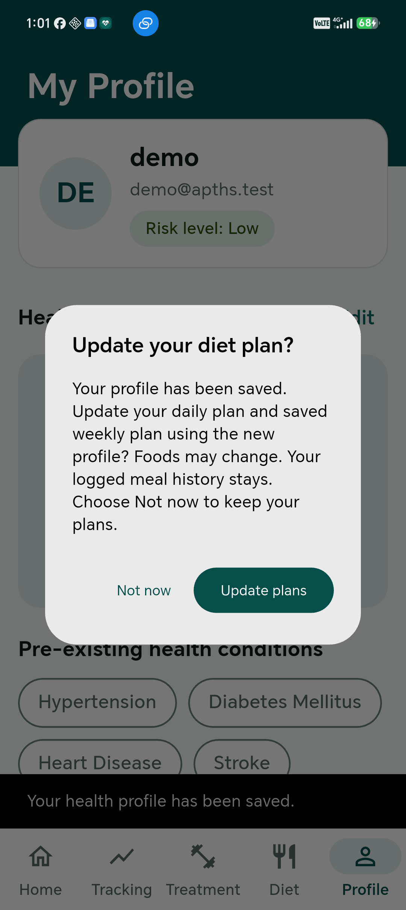

### jt-02-invalid-reading

Implausible reading rejected and Save disabled.

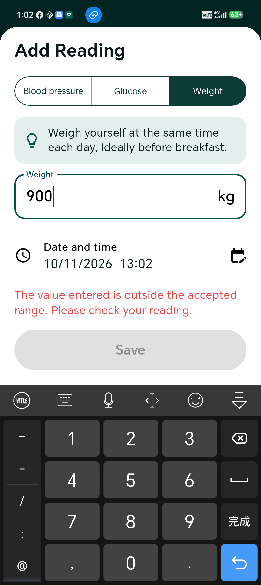

### jt-02-saved-reading

Valid weight appears in recent readings before confirmed deletion.

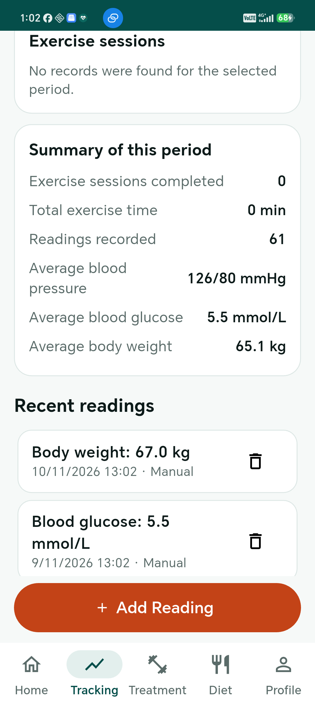

### jt-03-health-score

Health Score and analysis fixture displayed.

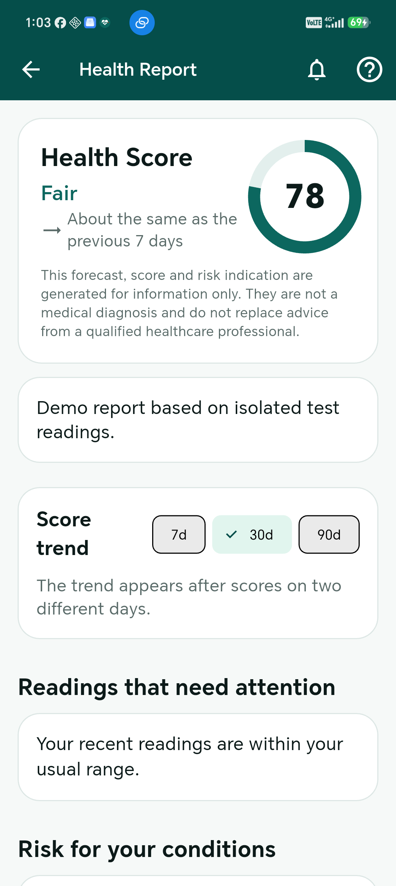

### jt-04-health-note

Stored health note opens for review.

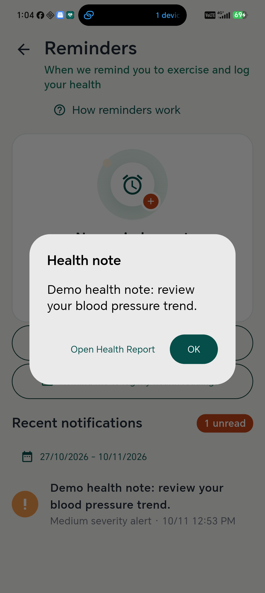

### jt-04-reminders

Health and meal reminder schedules created in the disposable scheduler.

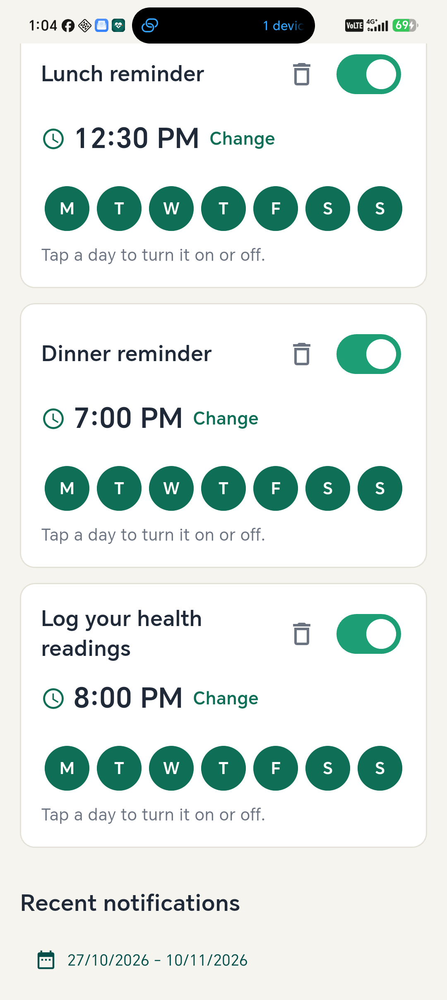

### jt-05-combined-papaya

Repeated papaya selections combined into 300 g.

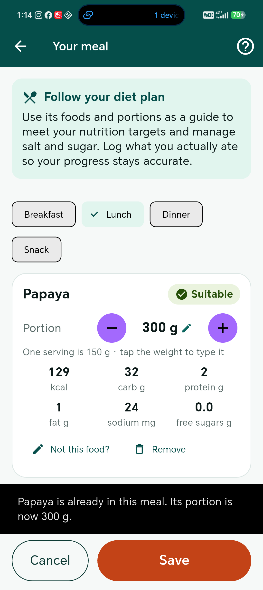

### jt-05-meal-history

Saved meal appears in history.

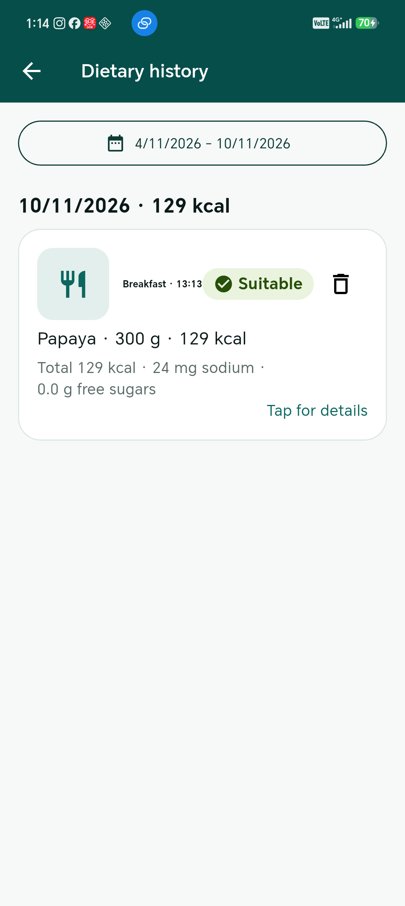

### jt-06-today-food-info

Today food opens its information sheet after replanning.

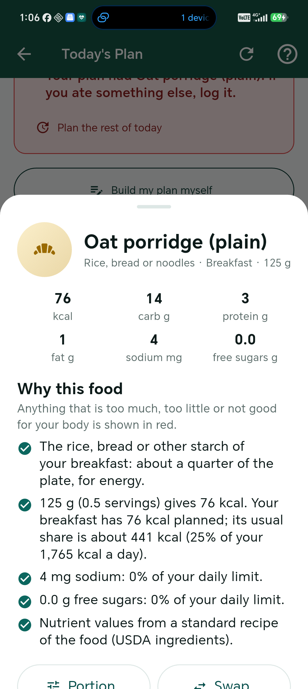

### jt-06-weekly-food-info

Weekly food opens its information sheet before explicit daily editing.

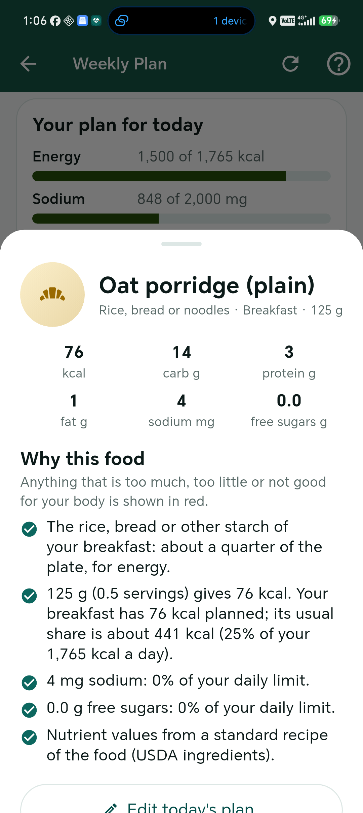

### jt-07-photo-review

Synthetic gallery image recognised as papaya and presented for review.

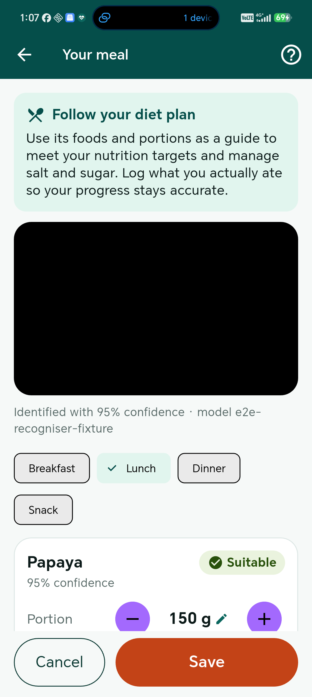

### jt-08-invalid-login

Invalid credentials produce an error.

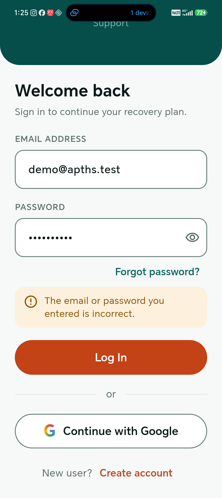

### jt-08-login-success

Correct credentials navigate to the signed-in app.

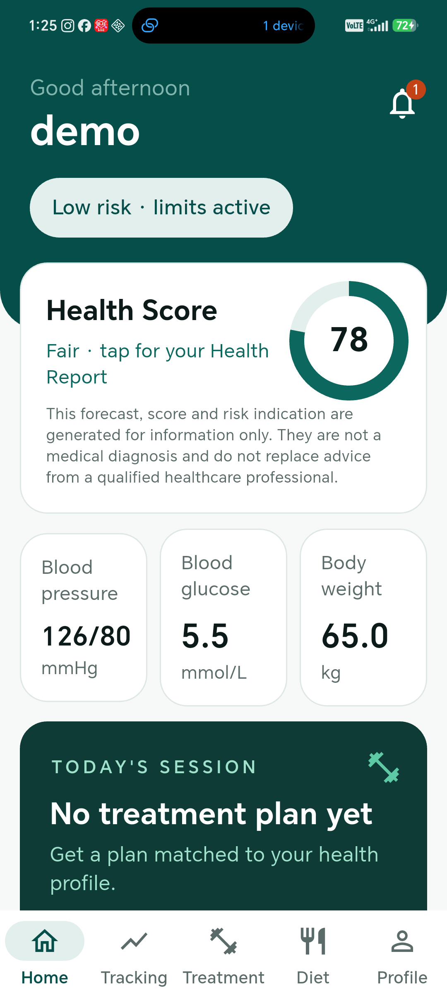

### jt-09-advisory-warning

Builder highlights a warned food before advisory save.

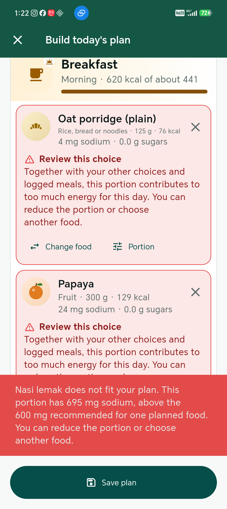

### jt-09-combined-draft

Builder combines repeated papaya portions.

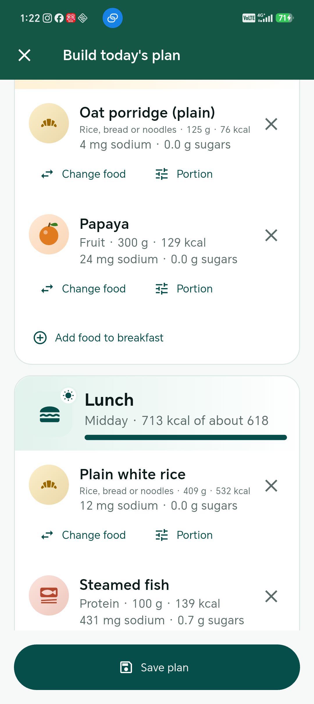
