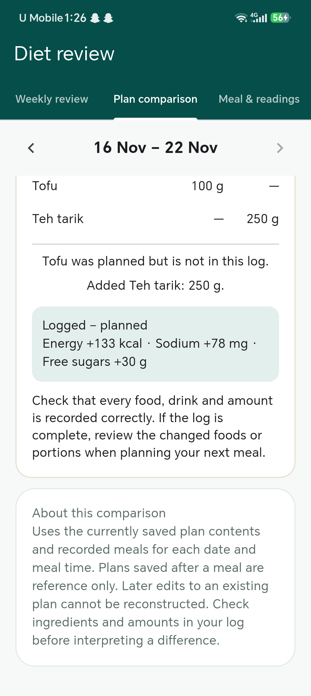
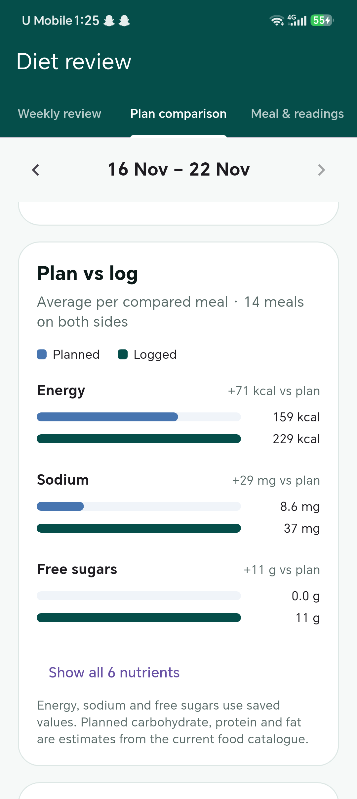
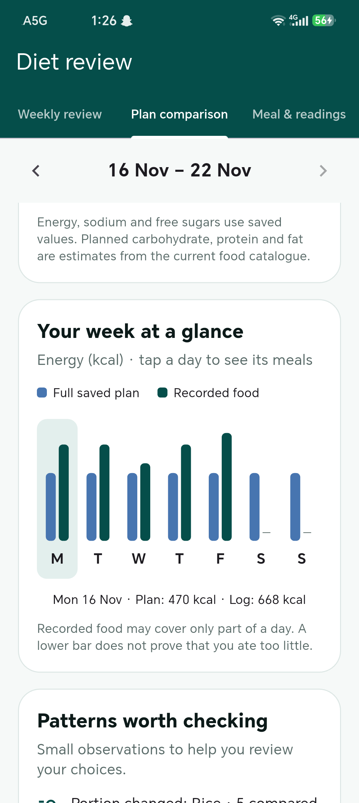
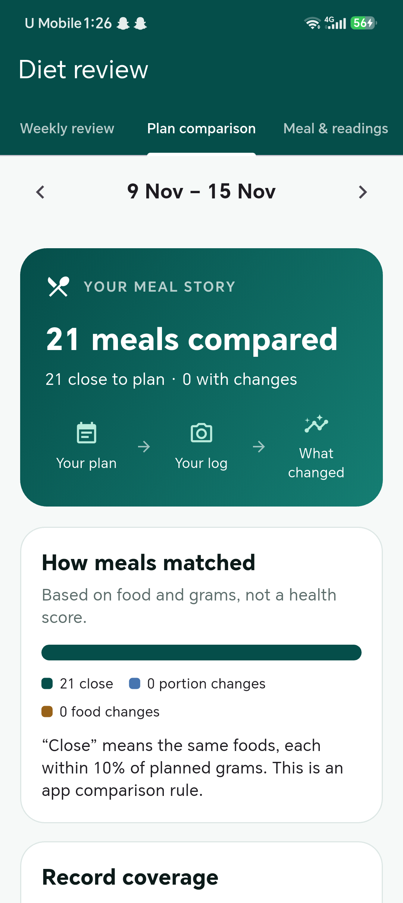
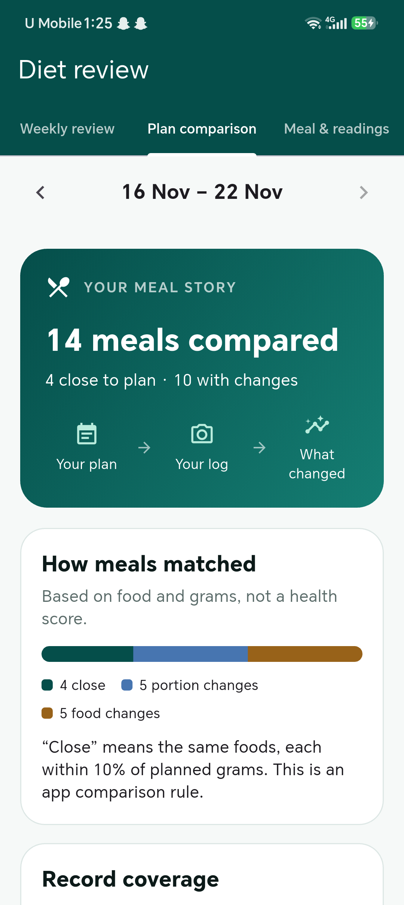
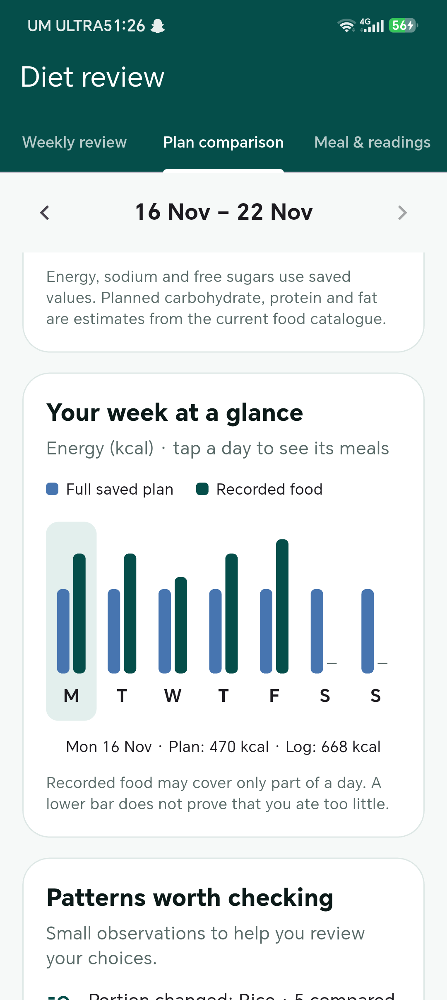

# Planned and logged meal comparison

The Diet review now has a Plan comparison tab. It compares saved plans with
recorded food by local date and meal time. The diagram and status bar distinguish
matching foods, changed portions and different foods. Nutrient bars compare the
same logged meal slots, and the weekly chart shows the full plan beside recorded
energy. Selecting a day filters the expandable food comparison cards. Repeated
food changes and previous-week averages include their sample counts.

The current fixture has 14 comparable meals: four close, five portion changes
and five food changes. There is also one planned meal without a log, six future
slots and one unplanned snack. The previous week has 21 comparable meals.
Fixtures use the production views and view model with disposable repositories;
they do not change saved health records or call an external analysis provider.

Validation on 20 November 2026:

- Full Flutter host suite: **687 passed** (`build/diet-comparison-full-tests-final.log`).
- Flutter analyzer: **no issues** (`build/diet-comparison-analyze-final.log`).
- HONOR LLY-NX1, Android 16: both Flutter Integration Tests passed in 10 seconds.
  They cover the populated comparison, all-six-nutrient expansion, selected-day
  filtering, meal details, previous-week counts and empty state.
- Maestro flow 14: **passed in 73 seconds**; all six screenshots are preserved in `evidence/`, with SHA-256 hashes in its manifest. Phone rotation was restored after the run.
- Repository transport checks exercise account and period filters, pagination,
  nested food parsing and query failures using simulated REST responses.
- Calculation tests cover stored nutrient snapshots, duplicate rows and meal
  IDs, account scoping, future and invalid records, missing logs, the 10%
  portion boundary, daily-plan precedence and retrospective references.

Missing logs remain unknown intake. The 10% rule describes portion similarity;
it is not a clinical score. Plans generated after any log in a slot are reference
only and excluded from averaged comparisons. The report uses currently saved
plan contents because edits to existing plans do not preserve historical versions.
Planned carbohydrate, protein and fat are labelled current-catalogue estimates;
saved energy, sodium and free sugars are preserved. These checks establish
calculation and UI behavior, not dietary completeness or clinical outcomes.

Run instructions are in [the integration test guide](../../../integration_test/README.md).

The final week-navigation check also verifies that selecting a different week
opens its summary at the top. Earlier attempts exposed scroll-position restoration
and Flutter accessibility label differences; these were corrected before the final
pass. One attempt was interrupted when the phone switched to another app.

Report v29 adds Table 5.23 with four phone screenshots embedded in the matching
Actual result cells. Its 483-page Word export was checked against v28; eight
changed page bodies and all four detailed evidence pages were visually reviewed.
The bundled renderer lacked LibreOffice, so hidden Word export and Poppler
provided the render used for layout checks.

